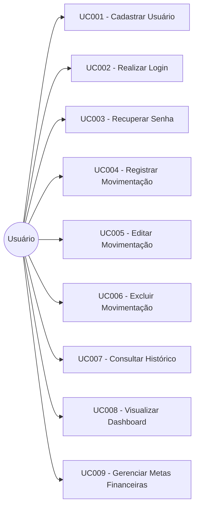

# Documento de Escopo do Sistema

**Projeto:** Sistema Web de Organização Financeira Pessoal
**Tipo de Documento:** Escopo do Sistema
**Ano:** 2026

---

## 1. Propósito / Visão Geral do Sistema

Grande parte das pessoas enfrenta dificuldades para manter controle sobre suas próprias finanças, seja pela ausência de hábito de registro, pela falta de ferramentas acessíveis ou pela complexidade de soluções bancárias tradicionais, que costumam ser voltadas a produtos financeiros e não ao simples acompanhamento do dia a dia. Essa carência de controle contribui para problemas comuns, como dificuldade em identificar para onde o dinheiro está indo, ausência de planejamento e dificuldade em atingir objetivos financeiros de curto e médio prazo.

O presente projeto tem como objetivo principal o desenvolvimento de um **sistema web de organização financeira pessoal**, que permita ao usuário registrar, visualizar e acompanhar suas receitas e despesas de forma simples, organizada e acessível, auxiliando-o a compreender melhor seus hábitos financeiros.

Os usuários do sistema são pessoas físicas que desejam controlar suas finanças pessoais, sem a necessidade de conhecimentos técnicos avançados, buscando uma ferramenta intuitiva para registro e acompanhamento de suas movimentações financeiras.

O sistema auxiliará na organização financeira pessoal ao centralizar em um único ambiente o registro de receitas e despesas, a categorização dessas movimentações e a visualização de resumos e indicadores financeiros, permitindo ao usuário ter uma visão clara de sua situação financeira em determinado período.

Entre os principais benefícios esperados, destacam-se:

* maior consciência sobre os próprios hábitos de consumo;
* facilidade para identificar excessos de gastos em determinadas categorias;
* melhor planejamento financeiro pessoal;
* acompanhamento simplificado de metas financeiras estabelecidas pelo próprio usuário;
* substituição de controles manuais (planilhas ou anotações) por uma ferramenta centralizada.

De forma resumida, o sistema funcionará por meio de um cadastro de usuário, que passará a ter acesso a um ambiente próprio onde poderá registrar suas movimentações financeiras (receitas e despesas), organizá-las por categorias, visualizar seu saldo atual, consultar um histórico de movimentações com filtros, acompanhar um dashboard com resumos financeiros e, opcionalmente, definir metas financeiras para acompanhamento de sua evolução.

Importante destacar que o sistema **não realiza movimentações bancárias reais**, servindo exclusivamente como uma ferramenta de registro e organização das informações financeiras informadas manualmente pelo usuário.

---

## 2. Requisitos Funcionais

### RF001
**Nome:** Cadastro de usuário
**Descrição:** O sistema deve permitir que um novo usuário realize seu cadastro, informando dados básicos como nome, e-mail e senha.
**Ator envolvido:** Usuário (visitante)
**Prioridade:** Essencial

### RF002
**Nome:** Login no sistema
**Descrição:** O sistema deve permitir que o usuário cadastrado realize login utilizando e-mail e senha para acessar sua conta pessoal.
**Ator envolvido:** Usuário
**Prioridade:** Essencial

### RF003
**Nome:** Logout do sistema
**Descrição:** O sistema deve permitir que o usuário encerre sua sessão de forma segura.
**Ator envolvido:** Usuário
**Prioridade:** Essencial

### RF004
**Nome:** Recuperação de senha
**Descrição:** O sistema deve permitir que o usuário solicite a redefinição de sua senha, caso a tenha esquecido, por meio de um processo de verificação via e-mail.
**Ator envolvido:** Usuário
**Prioridade:** Importante

### RF005
**Nome:** Gerenciamento do perfil
**Descrição:** O sistema deve permitir que o usuário visualize e edite suas informações cadastrais, como nome, e-mail e senha.
**Ator envolvido:** Usuário
**Prioridade:** Importante

### RF006
**Nome:** Registro de receita
**Descrição:** O sistema deve permitir que o usuário cadastre uma nova receita, informando valor, data, categoria e descrição opcional.
**Ator envolvido:** Usuário
**Prioridade:** Essencial

### RF007
**Nome:** Registro de despesa
**Descrição:** O sistema deve permitir que o usuário cadastre uma nova despesa, informando valor, data, categoria e descrição opcional.
**Ator envolvido:** Usuário
**Prioridade:** Essencial

### RF008
**Nome:** Edição de movimentação financeira
**Descrição:** O sistema deve permitir que o usuário edite uma receita ou despesa previamente cadastrada.
**Ator envolvido:** Usuário
**Prioridade:** Essencial

### RF009
**Nome:** Exclusão de movimentação financeira
**Descrição:** O sistema deve permitir que o usuário exclua uma receita ou despesa previamente cadastrada.
**Ator envolvido:** Usuário
**Prioridade:** Essencial

### RF010
**Nome:** Categorização de movimentações
**Descrição:** O sistema deve permitir a associação de categorias (como alimentação, transporte, moradia, lazer, salário, entre outras) às receitas e despesas cadastradas.
**Ator envolvido:** Usuário
**Prioridade:** Essencial

### RF011
**Nome:** Visualização de saldo
**Descrição:** O sistema deve calcular e exibir o saldo financeiro do usuário, considerando o total de receitas e despesas registradas.
**Ator envolvido:** Usuário
**Prioridade:** Essencial

### RF012
**Nome:** Histórico de movimentações
**Descrição:** O sistema deve exibir uma listagem com o histórico de todas as movimentações financeiras registradas pelo usuário.
**Ator envolvido:** Usuário
**Prioridade:** Essencial

### RF013
**Nome:** Filtro de movimentações por período e categoria
**Descrição:** O sistema deve permitir que o usuário filtre o histórico de movimentações por intervalo de datas e por categoria.
**Ator envolvido:** Usuário
**Prioridade:** Importante

### RF014
**Nome:** Dashboard financeiro
**Descrição:** O sistema deve apresentar um painel inicial (dashboard) com um resumo consolidado das informações financeiras do usuário, como saldo atual, total de receitas e total de despesas no período.
**Ator envolvido:** Usuário
**Prioridade:** Importante

### RF015
**Nome:** Gráficos de resumo financeiro
**Descrição:** O sistema deve apresentar gráficos ilustrativos (como gráfico de pizza ou barras) exibindo a distribuição de despesas e receitas por categoria.
**Ator envolvido:** Usuário
**Prioridade:** Desejável

### RF016
**Nome:** Definição de metas financeiras
**Descrição:** O sistema deve permitir que o usuário cadastre metas financeiras, informando um valor-alvo e um período para alcançá-la.
**Ator envolvido:** Usuário
**Prioridade:** Desejável

### RF017
**Nome:** Acompanhamento de metas financeiras
**Descrição:** O sistema deve exibir o progresso do usuário em relação às metas financeiras cadastradas, com base nas movimentações registradas.
**Ator envolvido:** Usuário
**Prioridade:** Desejável

---

## 3. Requisitos Não Funcionais

### RNF001
**Categoria:** Usabilidade
**Descrição:** O sistema deve possuir uma interface simples e intuitiva, permitindo que um usuário sem conhecimento técnico consiga registrar uma movimentação financeira em, no máximo, três etapas (telas ou cliques).
**Critério de aceitação ou justificativa:** Verificável por meio de teste de usabilidade com usuários reais, contabilizando o número de interações necessárias para concluir o cadastro de uma movimentação.

### RNF002
**Categoria:** Segurança
**Descrição:** As senhas dos usuários devem ser armazenadas de forma criptografada, não sendo mantidas em texto legível no banco de dados.
**Critério de aceitação ou justificativa:** Verificável por meio de inspeção direta dos dados armazenados, confirmando que a senha não é recuperável em formato original.

### RNF003
**Categoria:** Autenticação
**Descrição:** O sistema deve exigir autenticação do usuário para acesso a qualquer funcionalidade relacionada às suas movimentações financeiras.
**Critério de aceitação ou justificativa:** Verificável ao tentar acessar rotas internas do sistema sem estar autenticado, o que deve resultar em redirecionamento para a tela de login.

### RNF004
**Categoria:** Proteção dos dados financeiros
**Descrição:** Os dados financeiros de um usuário não devem ser acessíveis por outros usuários do sistema.
**Critério de aceitação ou justificativa:** Verificável por meio de testes de acesso, tentando consultar dados de outro usuário autenticado com uma conta diferente.

### RNF005
**Categoria:** Desempenho
**Descrição:** As operações de cadastro, edição e exclusão de movimentações financeiras devem ser processadas em até 3 segundos em condições normais de uso.
**Critério de aceitação ou justificativa:** Verificável por meio de testes de tempo de resposta das requisições realizadas ao sistema.

### RNF006
**Categoria:** Responsividade
**Descrição:** A interface do sistema deve se adaptar corretamente a diferentes tamanhos de tela, incluindo dispositivos desktop e mobile.
**Critério de aceitação ou justificativa:** Verificável por meio de testes de visualização em diferentes resoluções e dispositivos.

### RNF007
**Categoria:** Compatibilidade com navegadores
**Descrição:** O sistema deve funcionar corretamente nos navegadores Google Chrome, Mozilla Firefox e Microsoft Edge, em suas versões atualizadas.
**Critério de aceitação ou justificativa:** Verificável por meio de testes manuais de funcionamento nos navegadores citados.

### RNF008
**Categoria:** Confiabilidade
**Descrição:** O sistema deve garantir que uma movimentação financeira registrada não seja perdida em caso de falha durante o processamento da requisição, retornando mensagem de erro ao usuário quando o registro não for concluído com sucesso.
**Critério de aceitação ou justificativa:** Verificável por meio de testes de falha simulada durante o envio de dados.

### RNF009
**Categoria:** Manutenibilidade
**Descrição:** O código-fonte do sistema deve ser organizado em módulos ou camadas bem definidas, facilitando a manutenção e a evolução do sistema.
**Critério de aceitação ou justificativa:** Verificável por meio de análise da estrutura do projeto e separação de responsabilidades entre as camadas.

### RNF010
**Categoria:** Acessibilidade
**Descrição:** As principais telas do sistema devem seguir boas práticas básicas de acessibilidade, como uso de contraste adequado de cores e textos alternativos em ícones e imagens relevantes.
**Critério de aceitação ou justificativa:** Verificável por meio de checklist básico de acessibilidade aplicado às telas principais do sistema.

### RNF011
**Categoria:** Privacidade
**Descrição:** O sistema deve informar ao usuário, de forma clara, quais dados pessoais e financeiros são coletados e para qual finalidade são utilizados.
**Critério de aceitação ou justificativa:** Verificável pela existência de uma seção ou tela informativa sobre uso e tratamento de dados dentro do sistema.

### RNF012
**Categoria:** Disponibilidade
**Descrição:** O sistema deve estar disponível para uso durante o período de avaliação e apresentação do TCC, ressalvadas eventuais janelas de manutenção previamente informadas.
**Critério de aceitação ou justificativa:** Verificável pela ausência de indisponibilidades não planejadas durante o período de testes e apresentação.

---

## 4. Modelos de Casos de Uso

### Atores do sistema

**Usuário:** pessoa física que utiliza o sistema para registrar e acompanhar suas finanças pessoais. É o único ator humano do sistema, responsável por todas as interações relacionadas ao cadastro, autenticação e gerenciamento de suas movimentações financeiras.

**Sistema:** ator que representa o próprio sistema, responsável por processar automaticamente cálculos de saldo, geração de resumos e gráficos, e verificação do progresso de metas financeiras, sem intervenção direta do usuário nessas etapas.

---

### UC001 — Cadastrar Usuário

**Ator principal:** Usuário (visitante)
**Objetivo:** Permitir que uma nova pessoa crie uma conta no sistema.
**Pré-condições:** O usuário não deve possuir cadastro prévio com o mesmo e-mail.
**Pós-condições:** O usuário passa a ter uma conta ativa e pode realizar login no sistema.

**Fluxo principal:**
1. O usuário acessa a tela de cadastro.
2. O usuário informa nome, e-mail e senha.
3. O sistema valida os dados informados.
4. O sistema cria a conta do usuário.
5. O sistema exibe mensagem de sucesso e redireciona para a tela de login.

**Fluxos alternativos / exceções:**
1. Caso o e-mail informado já esteja cadastrado, o sistema exibe mensagem de erro e solicita novo e-mail.
2. Caso algum campo obrigatório não seja preenchido corretamente, o sistema exibe mensagem indicando o campo pendente.

**Requisitos relacionados:** RF001.

---

### UC002 — Realizar Login

**Ator principal:** Usuário
**Objetivo:** Permitir o acesso do usuário à sua conta pessoal no sistema.
**Pré-condições:** O usuário deve possuir cadastro ativo no sistema.
**Pós-condições:** O usuário é autenticado e direcionado ao dashboard do sistema.

**Fluxo principal:**
1. O usuário acessa a tela de login.
2. O usuário informa e-mail e senha.
3. O sistema valida as credenciais informadas.
4. O sistema autentica o usuário e o redireciona ao dashboard.

**Fluxos alternativos / exceções:**
1. Caso as credenciais estejam incorretas, o sistema exibe mensagem de erro e permite nova tentativa.
2. Caso o usuário tenha esquecido a senha, ele pode acessar a funcionalidade de recuperação de senha (UC003).

**Requisitos relacionados:** RF002.

---

### UC003 — Recuperar Senha

**Ator principal:** Usuário
**Objetivo:** Permitir que o usuário redefina sua senha caso a tenha esquecido.
**Pré-condições:** O usuário deve possuir cadastro ativo com e-mail válido.
**Pós-condições:** A senha do usuário é redefinida com sucesso.

**Fluxo principal:**
1. O usuário seleciona a opção "Esqueci minha senha".
2. O usuário informa o e-mail cadastrado.
3. O sistema envia um link ou código de verificação para o e-mail informado.
4. O usuário acessa o link e define uma nova senha.
5. O sistema confirma a redefinição da senha.

**Fluxos alternativos / exceções:**
1. Caso o e-mail informado não esteja cadastrado, o sistema exibe mensagem informando que não foi possível localizar a conta.

**Requisitos relacionados:** RF004.

---

### UC004 — Registrar Movimentação Financeira

**Ator principal:** Usuário
**Objetivo:** Permitir o registro de uma receita ou despesa.
**Pré-condições:** O usuário deve estar autenticado no sistema.
**Pós-condições:** A movimentação financeira é registrada e passa a compor o saldo e o histórico do usuário.

**Fluxo principal:**
1. O usuário acessa a opção de nova movimentação.
2. O usuário seleciona o tipo de movimentação (receita ou despesa).
3. O usuário informa valor, data, categoria e, opcionalmente, uma descrição.
4. O sistema valida os dados informados.
5. O sistema registra a movimentação.
6. O sistema atualiza o saldo e o histórico do usuário.

**Fluxos alternativos / exceções:**
1. Caso algum campo obrigatório esteja inválido ou ausente, o sistema exibe mensagem indicando o erro.

**Requisitos relacionados:** RF006, RF007, RF010.

---

### UC005 — Editar Movimentação Financeira

**Ator principal:** Usuário
**Objetivo:** Permitir a alteração de uma movimentação financeira previamente cadastrada.
**Pré-condições:** O usuário deve estar autenticado e possuir ao menos uma movimentação cadastrada.
**Pós-condições:** A movimentação financeira é atualizada com os novos dados informados.

**Fluxo principal:**
1. O usuário acessa o histórico de movimentações.
2. O usuário seleciona a movimentação que deseja editar.
3. O usuário altera os dados desejados.
4. O sistema valida os dados informados.
5. O sistema atualiza a movimentação e recalcula o saldo.

**Fluxos alternativos / exceções:**
1. Caso os dados informados sejam inválidos, o sistema exibe mensagem de erro e mantém os dados originais.

**Requisitos relacionados:** RF008.

---

### UC006 — Excluir Movimentação Financeira

**Ator principal:** Usuário
**Objetivo:** Permitir a remoção de uma movimentação financeira cadastrada.
**Pré-condições:** O usuário deve estar autenticado e possuir ao menos uma movimentação cadastrada.
**Pós-condições:** A movimentação é removida e o saldo do usuário é atualizado.

**Fluxo principal:**
1. O usuário acessa o histórico de movimentações.
2. O usuário seleciona a movimentação que deseja excluir.
3. O sistema solicita confirmação da exclusão.
4. O usuário confirma a exclusão.
5. O sistema remove a movimentação e recalcula o saldo.

**Fluxos alternativos / exceções:**
1. Caso o usuário cancele a confirmação, a movimentação não é excluída.

**Requisitos relacionados:** RF009.

---

### UC007 — Consultar Histórico de Movimentações

**Ator principal:** Usuário
**Objetivo:** Permitir a visualização e filtragem das movimentações financeiras registradas.
**Pré-condições:** O usuário deve estar autenticado no sistema.
**Pós-condições:** O usuário visualiza a listagem de movimentações conforme os filtros aplicados.

**Fluxo principal:**
1. O usuário acessa a tela de histórico de movimentações.
2. O sistema exibe a listagem completa das movimentações do usuário.
3. O usuário pode aplicar filtros por período e/ou categoria.
4. O sistema atualiza a listagem conforme os filtros selecionados.

**Fluxos alternativos / exceções:**
1. Caso não existam movimentações que atendam aos filtros aplicados, o sistema exibe mensagem informando que nenhum resultado foi encontrado.

**Requisitos relacionados:** RF012, RF013.

---

### UC008 — Visualizar Dashboard Financeiro

**Ator principal:** Usuário
**Objetivo:** Permitir que o usuário visualize um resumo consolidado de sua situação financeira.
**Pré-condições:** O usuário deve estar autenticado no sistema.
**Pós-condições:** O usuário visualiza as informações consolidadas de saldo, receitas, despesas e gráficos.

**Fluxo principal:**
1. O usuário realiza login no sistema.
2. O sistema calcula automaticamente o saldo, o total de receitas e o total de despesas do período.
3. O sistema exibe o dashboard com as informações consolidadas.
4. O sistema exibe gráficos com a distribuição de movimentações por categoria.

**Fluxos alternativos / exceções:**
1. Caso o usuário não possua movimentações cadastradas, o sistema exibe mensagem orientando o cadastro da primeira movimentação.

**Requisitos relacionados:** RF011, RF014, RF015.

---

### UC009 — Gerenciar Metas Financeiras

**Ator principal:** Usuário
**Objetivo:** Permitir que o usuário defina e acompanhe metas financeiras pessoais.
**Pré-condições:** O usuário deve estar autenticado no sistema.
**Pós-condições:** A meta financeira é cadastrada e passa a ser acompanhada pelo sistema.

**Fluxo principal:**
1. O usuário acessa a área de metas financeiras.
2. O usuário informa o valor-alvo e o período da meta.
3. O sistema registra a meta financeira.
4. O sistema calcula e exibe o progresso da meta com base nas movimentações registradas pelo usuário.

**Fluxos alternativos / exceções:**
1. Caso os dados informados sejam inválidos, o sistema exibe mensagem de erro.

**Requisitos relacionados:** RF016, RF017.

---

## 5. Diagrama Geral de Casos de Uso

---

## 6. Limites do Escopo

### Dentro do escopo

* Cadastro, login, logout e recuperação de senha de usuários.
* Gerenciamento de perfil do usuário.
* Registro, edição e exclusão de receitas e despesas.
* Categorização de movimentações financeiras.
* Cálculo e exibição de saldo financeiro.
* Histórico de movimentações com filtros por período e categoria.
* Dashboard financeiro com resumo das informações do usuário.
* Gráficos de resumo financeiro por categoria.
* Definição e acompanhamento de metas financeiras simples, com base nas movimentações registradas no próprio sistema.

### Fora do escopo

* Integração automática com contas bancárias ou instituições financeiras.
* Movimentação real de dinheiro entre contas.
* Realização de pagamentos, transferências ou cobranças.
* Compra, venda ou gestão automatizada de investimentos.
* Emissão de boletos, notas fiscais ou documentos financeiros oficiais.
* Funcionalidades de open finance ou conexão com APIs bancárias.
* Aplicativo mobile nativo (o sistema será desenvolvido como aplicação web).

---

## 7. Matriz de Rastreabilidade

| Requisito | Descrição resumida                      | Caso de Uso |
| --------- | ---------------------------------------- | ----------- |
| RF001     | Cadastro de usuário                      | UC001       |
| RF002     | Login no sistema                         | UC002       |
| RF003     | Logout do sistema                        | UC002       |
| RF004     | Recuperação de senha                     | UC003       |
| RF005     | Gerenciamento do perfil                  | —           |
| RF006     | Registro de receita                      | UC004       |
| RF007     | Registro de despesa                      | UC004       |
| RF008     | Edição de movimentação financeira        | UC005       |
| RF009     | Exclusão de movimentação financeira      | UC006       |
| RF010     | Categorização de movimentações           | UC004       |
| RF011     | Visualização de saldo                    | UC008       |
| RF012     | Histórico de movimentações               | UC007       |
| RF013     | Filtro por período e categoria           | UC007       |
| RF014     | Dashboard financeiro                     | UC008       |
| RF015     | Gráficos de resumo financeiro            | UC008       |
| RF016     | Definição de metas financeiras           | UC009       |
| RF017     | Acompanhamento de metas financeiras      | UC009       |